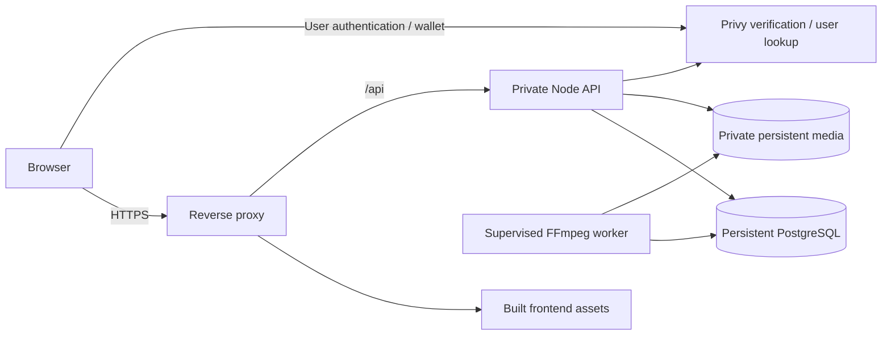

# MUNK hosting readiness — assessment only

2026-10-29 UTC. Read with [MUNK full-stack audit](MUNK-FULLSTACK-AUDIT.md), which contains the complete route/API/integration inventory, user journeys, evidence limitations and combined cleanup plan. No deployment, purchase, paid plan, provider configuration change or application implementation was performed.

## Decision

MUNK is **not ready for a complete publicly hosted creator-to-viewer demo**. It can build a substantial static fictional browsing experience and run private creator/auth/upload/review services, but publication, public actual-content resolution, range-capable media delivery and shared viewer interactions are missing. Real provider signup/recovery remains unverified. Hosting those pieces today would centralize the fixture preview and private tools, not make the promised product journey complete.

A small, invited, centralized demo is plausible after a bounded local vertical slice and an operational acceptance gate. Keep the existing visual system. Do not introduce trading, signing authority, financial onboarding or blockchain as a prerequisite.

Labels match the main audit: **Implemented and verified**, **Implemented but unverified**, **Local/browser-only**, **Fixture/simulation**, **Missing or blocked**. Passing native tests establish service behavior in isolated test data, not production readiness.

## Component readiness and required decisions

| Component | Existing implementation/evidence | Hosting gap / acceptance gate |
|---|---|---|
| Frontend static build | React18.3.1, Vite5.4.21, TypeScript5.9.3; current build passes into `frontend/dist`. Hash routes need only serve entry/assets, not server route parsing. `frontend/package.json`, `vite.config.ts`, `model.ts`. | Serve built assets only; never expose source, `.qa`, Vite, review folders or env files. Build public VITE variables for intended origin. No SSR/SEO/public dynamic catalog exists. Test asset base/cache behavior and 404s under target origin. |
| API | Fastify5, Node>=22, pg, real Privy verification/session code; live local health/ready200 and guest protected401; native HTTP permissions pass. `backend/src/server.ts`, `api/`, `auth/`. | No compiled backend distribution; `start` runs TypeScript using devDependency tsx. Define reproducible install/runtime packaging and process restart policy. Health does not cover provider/tools/media/worker. |
| PostgreSQL | Three forward/checksummed migrations, relational constraints, connection pool/TLS verification; native18.4 tests8/8 and process restart probe. `db/`, `migrations/`. | Persistent volume/service, restricted application role, backup/restore, connectivity/firewall/TLS, pool budget API+workers+migrations. No production migration/restore run performed. Do not carry local cluster passwords/data into a review ZIP. |
| Media storage | Private filesystem originals/MP4/posters, checksums, atomic durable writes, protected uploader/reviewer playback. `media/store.ts`, `domain/uploads.ts`. | Persistent shared mount API+worker; capacity/IOPS/disk alarms, backup, lifecycle/orphan cleanup. No object store adapter or public delivery. Output/source overhead beyond10GiB allocation quota must be budgeted. |
| Worker/FFmpeg | Durable SQL queue, SKIP LOCKED, leases/heartbeats, generation fencing, real H.264/AAC+poster tests. `jobs/processor.ts`, `media/process.ts`. | Supply patched compatible Linux/target binaries, resource caps, supervision, write access, restart/kill tests, job-age/failure metrics. No guaranteed queued-job latency or concurrency/load result. |
| Session/HTTPS topology | Secure cookie based on HTTPS APP_ORIGIN; SameSiteStrict, HttpOnly, origin+CSRF protections; same-origin dev proxy. | Same public HTTPS origin recommended. Verify cookies, passkeys/provider redirects and media after TLS termination; do not assume Vite proxy exists in static hosting. |
| Privy | Actual SDK initializes; signup/wallet/client recovery controls and server verifier exist. Source adds no developer signers. | Current local env presence check finds no nonempty secret. Verify locally supplied read-only secret and intended hosted app settings. Real account/wallet/recovery flow not yet accepted. No production app/paid plan enabled here. |
| Publishing/social | Tables and unavailable adapter only; local viewer features. | Implement minimum server work/publication/public lookup/media and shared interaction slice before claiming creator demo. |
| Operations | Sanitized request metadata, migration checksum readiness, graceful signals for API/worker. | No supervisor, alerting, scheduled backup, restore runbook, host hardening config, public TLS/reverse proxy config or deployment automation verified. |

## Recommended smallest topology

For an invited demo with a few creators and short videos, use one public HTTPS origin with a private API and worker. This is a proposal, not an installed environment:

Assume low invited concurrency, one worker initially, uploaded files <=2GiB and introductions <=512MiB, and no uptime guarantee beyond a demonstration. CPU/RAM/disk sizing must be measured using representative videos; low-resolution synthetic tests are not a capacity estimate. Shared media mount is essential: two independent ephemeral API/worker disks will fail despite sharing PostgreSQL. The database stores relative media keys, not file contents.

Retain `/api` under the frontend public origin so cookies remain same-origin; route it privately to loopback API. Build frontend once and serve `dist`. Set APP_ORIGIN to the exact intended HTTPS origin using local/host secret configuration, and configure Secure cookies accordingly. Do not publish developer `.env`, runtime media originals, PostgreSQL ports, inspector/CDP ports or Vite. Public media should be exposed only through publication-aware delivery added in the approved next implementation, not by mapping all MEDIA_ROOT into static hosting.

The existing backend's `trustProxy:false` ignores forwarded client identity. Behind a single reverse proxy, sign-in rate windows may count every visitor as the proxy IP. Simply enabling blanket trust would allow spoofing if the API is reachable directly. A follow-up must establish a trusted proxy boundary and rate-limit design, with tests that forged forwarded headers cannot evade limits. Preserve the client's Origin header; don't rewrite it to an internal host. Proxy request/response timeouts and upload limits need deliberate alignment with Fastify's30-minute request timeout and 2GiB stream cap.

Nginx's body-size and proxy request-buffering behavior need explicit configuration for these large streams; default assumptions are insufficient. Buffering an entire2GiB body at the edge can require additional temporary disk and delay receipt. This assessment does not prescribe an untested config. Confirm limits/timeouts/error propagation in the selected proxy and any upstream CDN. See [Nginx core body-size documentation](https://nginx.org/en/docs/http/ngx_http_core_module.html#client_max_body_size) and [proxy request buffering documentation](https://nginx.org/en/docs/http/ngx_http_proxy_module.html#proxy_request_buffering), retrieved2026-10-29.

## Independent frontend/API hosting

`frontend/src/api.ts` supports absolute VITE_API_BASE_URL with credentials included, but this is **not evidence of working cross-origin hosting**. The API currently has no CORS responses/OPTIONS preflight support. JSON/CSRF/idempotency headers trigger preflight; SameSiteStrict blocks cross-site cookies; private media elements add their own cookie/CORS considerations. A different frontend/API origin therefore needs tested changes and a security decision, not merely swapping an env value.

Separate infrastructure can still present a same public origin through an edge/reverse proxy. This preserves current app assumptions and is the smallest path. If independent public origins become necessary, define an explicit allowlist, credentialed CORS, allowed headers/methods, OPTIONS handling, cookie-domain/site policy and CSRF protections, then test real browsers. Do not relax all origins or use a fixture session to make a hosted preview look authenticated.

## Single-server versus managed services

| Dimension | Small single server | Managed approach |
|---|---|---|
| Components | HTTPS/static proxy, Node API, worker, PostgreSQL and persistent media disk on one host. | Static hosting/edge, API service/container, persistent worker, managed PostgreSQL, object storage/CDN. |
| Fit to current source | Closest: local filesystem can be shared directly; same-origin proxy natural. Needs packaging/supervisor/backup. | Requires media adapter/delivery design and network topology; API/worker containers cannot rely on unrelated ephemeral disks. |
| Reliability | One machine/storage failure affects all components; operator handles updates, recoveries and capacity. | Separates failure domains and can provide managed backup options; configuration/integration and provider limits still require validation. |
| Processing | Worker competes with API/DB for CPU/memory/IO; start with enforced concurrency. | Worker can scale separately, but persistent job leases/storage traffic and FFmpeg resource limits must be tested. |
| Upload/media | Large requests traverse one proxy; disk/egress/backup owned by operator. | API/platform request limits may be below2GiB/30minutes; presigned/direct multipart design could be required and is not implemented. |
| Operational complexity | Fewer services, more responsibility on one operator; restore of DB+media must be coordinated. | More credentials/origins/IAM/networking; provider DB backups do not back up object files or establish app restore correctness. |
| Cost assumptions | Compute, persistent disk, off-host backups, bandwidth/egress, DNS/domain and operator time. | Frontend bandwidth, API/worker runtime, DB/storage/backup, object operations/egress/CDN and operator time. |
| Recommendation | Smallest first invited demo once local functional slice and restore/restart/security gates pass. | Consider when concurrent processing, durability/operational needs or measured load justify adapter/infra work. |

No dollar estimates are quoted: provider/region, audience, video sizes, retention, egress, availability targets and plan eligibility have not been chosen. A free-tier assumption would be unreliable for persistent PostgreSQL, always-running workers and large media. No service subscription, resource or paid plan was created. Obtain current official provider quotes only after these assumptions are fixed and user approval is requested for a concrete proposal.

## Privy hosted-environment gate

The source defaults to the supplied development app ID. Do not silently repurpose production configuration or assume development users/passkeys/wallets transfer to another app. Privy documentation states that users, wallets, policies and API credentials are scoped to apps and recommends separate apps to segregate environments. See [official dashboard overview](https://docs.privy.io/basics/get-started/dashboard/overview), retrieved2026-10-29. Dashboard configuration and provider limits were not read through an authenticated dashboard in this audit.

Before a hosted demo, separately review the actual dashboard's current origin/app-mode requirements and passkey relying-party behavior for its exact HTTPS hostname; development localhost behavior does not prove a hosted domain works. Preserve user-owned wallets, no additional MUNK signer/delegation, and least-privilege read-only server user lookup. Enter any secret only into a local ignored backend env or host secret manager, never chat or VITE variables. Verify that the app ID matches frontend and backend. MUNK's code cannot prove the actual secret's configured scopes.

Real acceptance must cover signup→wallet setup→server session, reload, logout/new provider session→same MUNK account, existing-wallet connection, same-account backup email linking/OTP and a supported recovery scenario on another device. A backup email sign-in method alone is not a verified wallet recovery guarantee. Privy's [user help center](https://www.privy.io/user-help-center) notes limits on recovery of lost primary login methods; MUNK should retain its plain-language warning. No key export should be included in test evidence; only success/failure metadata, with no secret material. This audit did not perform these actions.

## Backup, restore, migration and monitoring gate

Current PostgreSQL/media persistence survives the isolated tests' reopen/restart scenarios. That is distinct from recovering a machine or accidentally deleted records. PostgreSQL's supported backup categories include logical dumps, filesystem backups and continuous archiving; see [official PostgreSQL18 backup documentation](https://www.postgresql.org/docs/current/backup.html), retrieved2026-10-29. Select a method appropriate to the demo's data-loss target; none is currently configured by this application.

Minimum runbook before hosting:

1. Review/pin a clean source/lockfile baseline; target-OS installation/build and API+worker startup must be reproducible. Current files are mostly untracked. No commit performed here.
2. Provision PostgreSQL/media durable storage and least-privilege service identities; keep provider/database secrets out of logs/build/static assets. API/worker must have matching configuration and media root.
3. Run checksummed migrations as a controlled one-shot step before serving traffic. Snapshot first; no destructive rollback script exists. Readiness must fail on pending/drifted migrations; operator should have a forward-fix/restore procedure.
4. Define a consistent backup boundary for PostgreSQL and referenced original/playback/poster files. Pause writes/worker or use a proven snapshot/backup protocol; an uncoordinated file copy and unrelated SQL dump can miss committed assets. Encrypt and retain an off-host copy; document retention/access/RPO/RTO.
5. Restore a sanitized test backup into a fresh isolated DB/media directory, apply only appropriate migrations, validate relationships/checksums and play/seek the restored processed video. Never place backups/private media in this audit ZIP.
6. Supervise API/worker, handle SIGTERM/draining and restart on failure; test interrupted upload, worker death during encode, database unavailability and disk-full behavior. Existing lease tests use injected timestamps, not production chaos testing.
7. Monitor API health/readiness/latency/5xx, DB pool errors/disk, media free space/inodes, queued-job age/failures/worker heartbeat, process exits and backup/restore freshness. Preserve request IDs while keeping tokens/headers/bodies/private filenames out of logs. Current logs intentionally hide raw error detail; add safe diagnostic codes before operational support.
8. Restrict uploads beyond per-House allocated quota: admission/size/concurrency/rate/disk controls, orphan cleanup and reviewed evidence retention. No sweeper/global storage limiter or antivirus pipeline exists. Do not delete evidence to free disk without explicit lifecycle rules.

These are proposed acceptance criteria, not assertions of installed controls.

## Platform assumptions and blockers

`backend/src/db/local-postgres.ts` intentionally supports **darwin-x64 only**, downloaded native PostgreSQL18 binaries and `backend/.data/postgresql`, localhost listener/port55432 and private generated connection files. It is a development convenience, not a portable hosted database launcher. Do not reuse the disposable native-test runner for persistent demo data or retry Homebrew source builds. Use an appropriate target platform PostgreSQL distribution/service later.

Browser scripts hardcode `/Applications/Google Chrome.app/...`, fixed CDP ports and use `.qa` temporary bundles; they are local QA tooling. FFmpeg/ffprobe paths may be machine-specific in env. The API's code resolves MEDIA_ROOT under backend unless explicitly absolute. Node's `--env-file-if-exists`/tsx startup and workspace-relative contract source imports require the repository/runtime context. Build output alone is not a standalone API artifact. No Dockerfile/CI/host supervisor/reverse proxy config is present or verified. Platform/version choices, especially native binaries, must be pinned/tested before any deployment is proposed.

Dependency registry check currently flags34 package entries,22high/12moderate. The main audit separates dev-only Vite/esbuild from frontend SDK graph and uncertain transitive backend reachability. Do not expose a development server; do not assume registry silence on a direct API dependency proves safety. No dependency upgrade was executed.

## Go/no-go acceptance for the next milestone

**Local functional demo gate:** real two-account Privy acceptance; explicit House membership/selection; separate reviewer approves ready actual intro; creator stores video metadata and publishes a ready asset; independent guest resolves and seeks actual footage; second account posts a shared interaction visible to creator; unpublish prevents public access; service restart retains all required data/media. Keep messaging/trading unavailable and sample catalog unmistakably fictional. The publication/social parts require approved implementation, not audit changes.

**Hosted invited demo gate:** above plus same-origin HTTPS/cookie/provider verification, target-OS reproducible startup, persistent storage, upload limits/rate controls, portable worker/tool packaging, safe trusted-proxy behavior, current dependency risk triage, supervisor/monitoring and a successful isolated DB+media restore drill. Set an audience/retention/availability limit and obtain concrete infrastructure approval separately.

The smallest next step is to verify and repair only the real local account journey, then complete one real House/video/interaction vertical slice. Hosting is the subsequent gate. Blockchain and financial work remain deferred. This assessment does not recommend or claim production readiness.
